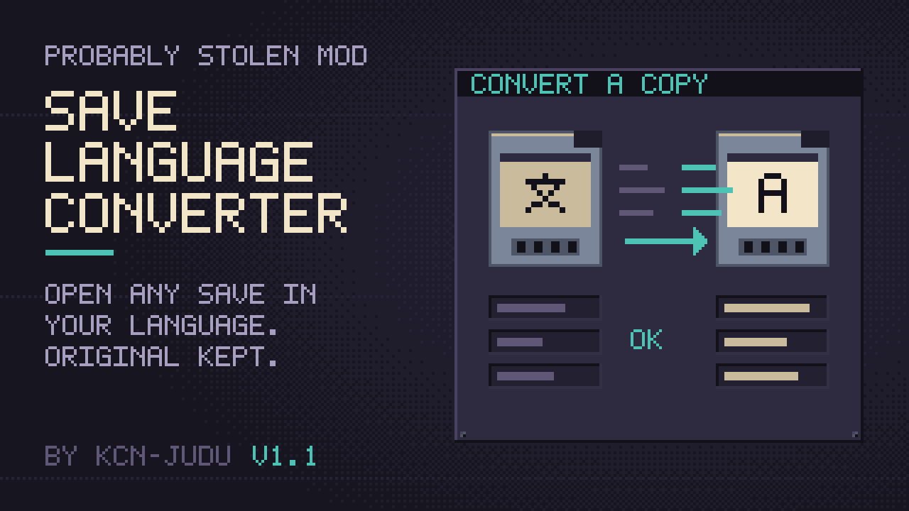

# Save Language Converter



A mod for *Probably Stolen*. It converts a copy of a save started in another language to the language you play in, using the game's own translations. Item names, descriptions, customers, news and logs change. The original save is never touched.

**Documentation:** <https://kcn-judu.github.io/ProbablyStolen-Mods/en/save-language-converter/> ([简体中文](https://kcn-judu.github.io/ProbablyStolen-Mods/zh-cn/save-language-converter/))

Part of the [Probably Stolen mods collection](https://github.com/KCN-judu/ProbablyStolen-Mods).

## Install

Subscribe on the [Steam Workshop](https://steamcommunity.com/sharedfiles/filedetails/?id=3832481427), or copy the folder from a [release](https://github.com/KCN-judu/ProbablyStolen-SaveLanguageConverter/releases) into the game's `Mods` folder. Then enable the mod in the game's Mods menu and restart the game.

## Build

```bash
./build.sh            # out/save_language_converter
./build.sh --install  # also copies it to the game's Mods folder
```

See [Building](doc/manual/building.md) for the requirements and the `GAME` and `CSC` variables.

## Repository layout

| Path | Contents |
| --- | --- |
| `src/` | The mod's source; `*.Pure.cs` files hold the decisions that tests/ check without the game |
| `Localization/` | The mod's own texts (button, messages, language names) in every language the game supports |
| `tests/` | Headless tests of the engine, and the scanner check |
| `tools/` | Programs that read the game's DLL; `Closure.cs` generates `src/KnownTypes.g.cs` |
| `doc/manual/` | Documentation, in English (the source of every translation) |
| `doc/locale/` | Translations of the documentation, as gettext catalogs |
| `manifest.xml`, `preview.png` | What the game reads, next to the DLL |
| `WORKSHOP.txt` | The Steam Workshop description, in BBCode |
| `CHANGELOG.md` | Changes by version |

## License

[Apache License 2.0](LICENSE).
