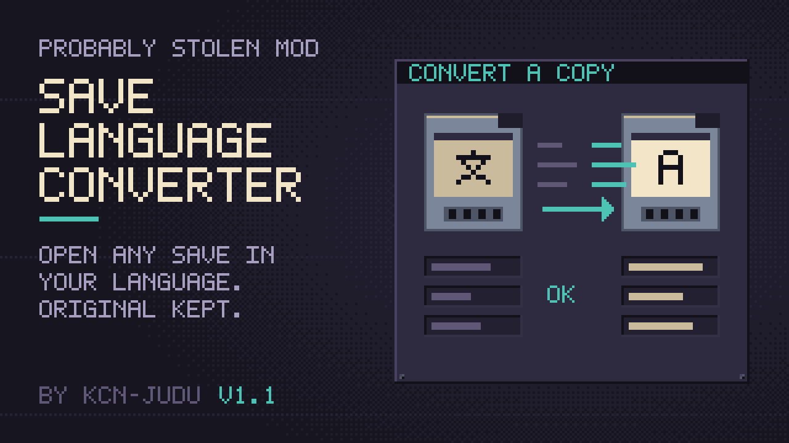

# Save Language Converter

Started a save in one language and now play in another? Item names, customers, news and logs stay in the old language. This mod converts a copy of the save to the language you play in, using the game's own translations.

## Using it

1. Load a save that was started in another language. The game warns that some text may display incorrectly.
2. The warning now has a third button, **Convert a copy**.
3. The save is duplicated with the game's own slot copy, all earlier days included, and the copy is loaded.
4. Right after the game reads the copy, and before inventories are rebuilt, every piece of text the game wrote in the old language is switched to the current one.
5. The game's next normal save writes the converted text. Earlier days of the copy are converted the same way when you load them.

If you changed the language since starting the game, the copy is made but not loaded, and a message asks you to restart the game first. The game fixes some text, such as the water qualities customers ask for, in the language it started in and keeps it until a restart, so a copy loaded right away would mix the two languages. After the restart, load the copy: it is converted then.

Choosing **Confirm** still loads the save unchanged. The original save is never modified.

## What is converted

Item names and descriptions, liquids, customers, factions, news, night logs and notes. The conversion works between any two of the game's languages.

## Limits

- Text added by other mods is not converted. Only the game's own string tables are used.
- Text that is not game text, such as names you typed or custom labels, stays as written.
- Tested against game version 0.46D.
